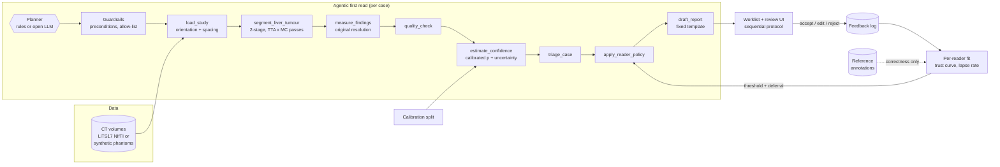
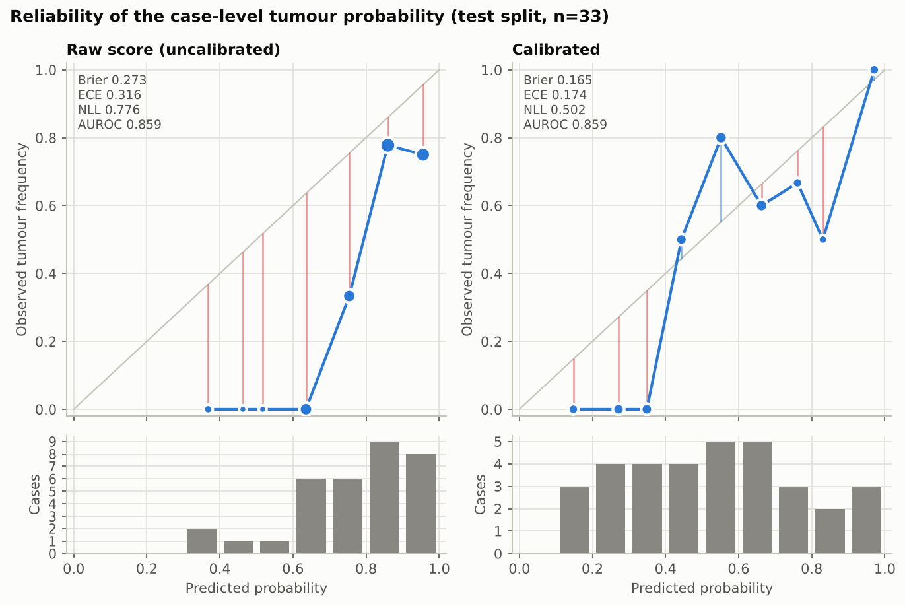
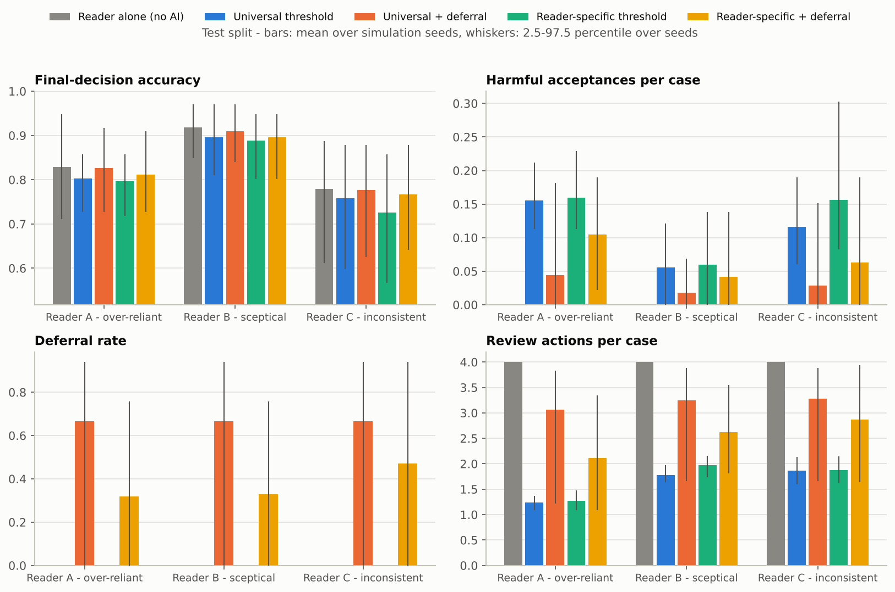
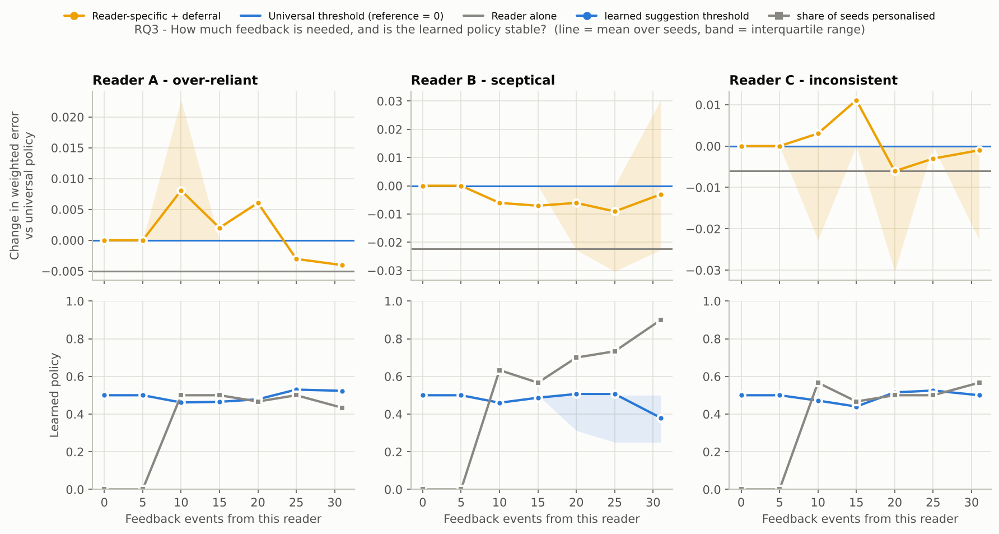

# ReaderAdapt-Liver

**A self-adapting, radiologist-centred first-read agent for liver CT** - a working prototype.

> Research question of the project: *can an AI assistant adapt to the individual radiologist, rather than
> offering the same support to every reader?*

The agent performs the routine part of a read - it **triages the worklist, segments and measures liver
tumours, attaches a calibrated confidence and drafts a structured report**. The radiologist stays responsible
for every decision and **accepts, edits or rejects** each suggestion. Those actions are logged and used to learn
**how each reader uses the AI**, so the system can change its suggestion threshold and **defer** cases to an
independent read for readers (and cases) where its help would do more harm than good.

> ⚠️ **Research prototype - not for clinical use.** Public, de-identified data only. Simulated readers show that
> the method behaves as designed; they are not evidence of clinical benefit.

---

## Contents
1. [What is in the box](#1-what-is-in-the-box)
2. [Architecture](#2-architecture)
3. [Quick start (CPU demo, ~20 min)](#3-quick-start-cpu-demo)
4. [Real data: LiTS17 + ViT-UNETR on a GPU](#4-real-data-lits17--vit-unetr-on-a-gpu)
5. [5-minute walkthrough for the coordinator](#5-five-minute-walkthrough)
6. [Methods](#6-methods)
7. [Results of the demo run](#7-results-of-the-demo-run)
8. [Repository layout, tests](#8-repository-layout-and-tests)
9. [Limitations and next steps](#9-limitations-and-next-steps)

---

## 1. What is in the box

| | Component | Where |
|---|---|---|
| **Aim 1 - agentic first read** | Planner (deterministic rules **or an open LLM** through any OpenAI-compatible server, e.g. Ollama) that calls guarded tools: load study → segment → measure → QC → calibrated confidence → triage → reader policy → report | `radagent/agent/` |
| | Segmentation tools behind one interface: **ViT-UNETR 2.5D** (my liver model, extended to liver + tumour), a 2.5D U-Net, and a CPU voxel-GBM baseline | `radagent/models/` |
| | Measurements at **original resolution from header voxel spacing**; lesion volumes and RECIST-like diameters | `radagent/measure.py`, `radagent/geometry.py` |
| | **Confidence calibration** (temperature / Platt chosen by CV on a calibration split), Brier, ECE, reliability diagrams | `radagent/calibration.py` |
| | Deterministic, template-based **report draft** (no LLM writes clinical text) | `radagent/report.py` |
| **Aim 2 - learning from corrections** | Accept / edit / reject feedback log, **per-reader trust curve**, reader-specific threshold and **learning to defer** | `radagent/policy.py`, `radagent/readers/` |
| **Aim 3 - evaluation** | Synthetic readers A (over-reliant), B (sceptical), C (inconsistent); universal vs reader-specific vs deferral policies on the same held-out cases; RQ1-RQ3 analyses | `radagent/experiments.py`, `notebooks/evaluation.ipynb` |
| Reading interface | Streamlit app: worklist, CT viewer with overlays + uncertainty, sequential reading protocol, accept/edit/reject, report, live policy adaptation, evaluation, agent trace | `app/streamlit_app.py` |

---

## 2. Architecture



* **Tools compute, planners only choose.** A planner proposes the next tool; the runner checks it against an
  allow-list and the tool's preconditions and falls back to the rule planner (logged as a *guardrail override*)
  if the proposal is invalid. The LLM never sees pixels and never writes a finding.
* **Feedback never becomes ground truth.** Reader actions teach the system *how this reader uses the AI*;
  whether a decision was right always comes from the reference annotation.

---

## 3. Quick start (CPU demo)

The demo runs the **entire workflow on a laptop** with synthetic LiTS-style CT phantoms and the CPU segmenter
(no GPU, no 15 GB download).

```bash
git clone <this repo> && cd readeradapt-liver
python -m venv .venv && source .venv/bin/activate      # Windows: .venv\Scripts\activate
pip install -r requirements.txt

python -m radagent all --config configs/demo.yaml      # ~15-25 min on 2 CPU cores
streamlit run app/streamlit_app.py -- --run outputs/demo
```

`all` = `data → train → infer → calibrate → first-read → simulate → figures`; each step is also its own command
(`python -m radagent --help`). Steps are cached, so re-running is fast. Single-case agent demo:

```bash
python -m radagent agent --config configs/demo.yaml                 # rule planner, prints the trace
python -m radagent agent --config configs/demo.yaml --planner llm   # open LLM planner (see below)
```

**Open-LLM planner (optional).** Install [Ollama](https://ollama.com), `ollama pull qwen2.5:7b-instruct`, keep
`ollama serve` running; `agent.llm` in the config points at `http://localhost:11434/v1`. Any OpenAI-compatible
server (vLLM, LM Studio, llama.cpp) works. If the server is unreachable or a proposal is invalid, the rule planner
takes over and the trace says so.

**PyTorch U-Net on the phantoms:** `pip install -r requirements-deep.txt` then
`python -m radagent all --config configs/demo_unet.yaml`.

---

## 4. Real data: LiTS17 + ViT-UNETR on a GPU

Open `notebooks/colab_lits_pipeline.ipynb` in Colab (GPU runtime, Kaggle token in Secrets as in the original
notebook). It downloads LiTS, trains the **3-class ViT-UNETR 2.5D**, runs the agent on the held-out cases and
packages the run folder for the app.

**Re-using the ViT-UNETR liver model.** The architecture is taken from my liver-segmentation notebook
(ImageNet ViT-Small encoder, U-Net decoder, CNN side-branch, 2.5D input). Changes:

* 3 output classes (background / liver / tumour), `Dropout2d` before the head for MC-dropout uncertainty;
* **warm start** from the 2-class liver checkpoint - every tensor except the 2-class head is loaded
  (`segmenter.init_from`); add `torch.save(model.state_dict(), "vitunetr_liver_2class.pt")` to the notebook;
* **leakage-safe split** (`split_strategy: notebook_compatible`): the notebook's exact split is reproduced
  (`RandomState(42)`, 80-case training pool), so the warm-started model has never seen any of the 51 held-out
  cases used here for calibration (26) and testing (25);
* the cosine LR schedule spans all optimiser steps (the notebook's `CosineAnnealingLR(T_max=epochs)` was stepped
  per batch, so the LR restarted every 30 steps);
* Dice + class-weighted CE on liver *and* tumour, tumour-slice oversampling, model selection on validation Dice.

Locally afterwards: unzip the downloaded run into `outputs/` and
`streamlit run app/streamlit_app.py -- --run outputs/lits_vitunetr`.

---

## 5. Five-minute walkthrough

1. **Worklist** tab - cases ranked by the agent (🔴 urgent, 🟠 suspicious, 🟣 uncertain, 🟢 likely normal,
   🧑‍⚕️ deferred). Switch the sidebar *Decision policy* and *Reader* and watch categories, the suggestion
   threshold and the deferred cases change.
2. **Case review** - pick a case in the sidebar. Scroll slices; toggle the AI liver/lesion outlines and the
   voxel-entropy map. As *Live reader*, the **sequential protocol** asks for your independent impression before
   the AI suggestion is revealed; then **Accept / Edit (keep or drop lesions) / Reject**.
3. Choose *Reader B - sceptical* and press **⏩ Simulate N reads** - the policy is refitted after every read.
4. **Reader adaptation** - the reader's threshold/deferral trajectory and the learned *trust curve* (with the
   true simulated curve for comparison).
5. **Report draft** - the deterministic report, including the reader's decision; downloadable.
6. **Evaluation** - calibration, policy comparison, RQ1/RQ3 figures. **Agent trace** - every tool call, reason,
   timing; re-run the case with the rule or LLM planner.

Turn on *Research mode* in the sidebar to overlay the reference annotation and label each decision as a correct
acceptance, harmful acceptance, correct or wrong rejection.

---

## 6. Methods

### 6.1 Geometry and measurement (Step 1)
Every NIfTI is re-ordered to the closest canonical **RAS+** orientation from its affine (LiTS mixes storage
orders) and shown in the radiological axial view (patient right on the left, anterior up). Voxel spacing is read
from the header, never assumed. Inference runs at the model resolution (128 or 256 px), the **class
probabilities are resized back to the original grid** and every volume is `n_voxels × dz × drow × dcol`.
Lesions are 3D connected components inside the liver that are ≥ `min_lesion_ml` (0.1 ml) and reach a peak tumour
probability ≥ 0.7; for each: volume, longest axial diameter on its largest cross-section, slice range, mean HU,
mean probability.

### 6.2 Two-stage, uncertainty-aware inference
Stage 1: one deterministic pass over all slices locates the liver slab. Stage 2: all stochastic passes on the
slab only - **flip-TTA × MC-dropout** for the networks, **bootstrap-ensemble members** for the CPU baseline.

### 6.3 Case-level score, calibration, uncertainty (Step 2)
* Raw score `p_raw` = mean of the *k* highest (slightly smoothed) tumour probabilities inside the liver, *k*
  voxels = 0.1 ml - "is there a lesion of at least 0.1 ml the model believes in?".
* Calibration on the **calibration split only**: identity vs temperature scaling vs Platt scaling, selected by
  5-fold CV negative log-likelihood, refitted on the whole calibration split, evaluated **once** on the test
  split (Brier, ECE with equal-width and equal-mass bins, NLL, AUROC, 95 % bootstrap intervals, reliability
  diagram).
* `uncertainty` = predictive entropy (bits) of the calibrated probability - for a calibrated model the expected
  error of the suggestion is `min(p, 1−p)`, so this is the natural score for selective prediction and deferral.
  The stochastic passes give the standard decomposition *total = expected entropy (aleatoric) + mutual
  information (epistemic, "model disagreement")*; both parts are reported in the record, the UI and the report.

### 6.4 Quality control and triage (Step 3)
QC checks (liver found, plausible liver volume, spacing, slice count, tumour voxels outside the liver) route a
case to a manual read. Priority = 0.60 · p + 0.25 · log-volume term + 0.15 · uncertainty, categories URGENT /
SUSPICIOUS / UNCERTAIN / LIKELY NORMAL / QC FAIL. The report is a fixed template filled with these values.

### 6.5 Reader model, feedback and personalisation (Step 4)
Simulated readers follow a **sequential reading protocol**: independent impression → AI suggestion → final
decision. Own reads depend on lesion size **and conspicuity** (`P(call) = σ(a + b·log10 V + c·(|Δ| − 20)/10)`,
Δ = tumour-minus-liver attenuation measured from the image and the reference mask, so small or faint lesions are
missed by readers *and* the model); tumour-free cases get a fixed false-positive rate. On disagreement the reader
switches to the AI with probability `σ(k·(conf − τ))` (*trust curve*); lapses make decisions random; poor outlines
are edited.

| | own-read sensitivity | false-positive rate | trust curve | lapses | role |
|---|---|---|---|---|---|
| Reader A | medium | 12 % | switches easily (τ = 0.55, k = 8) | 2 % | over-reliant |
| Reader B | conservative (misses small lesions) | 4 % | almost never switches (τ = 0.97) | 2 % | sceptical, rejects many |
| Reader C | lower | 15 % | flat (k = 1.5) | 15 % | inconsistent |

From a reader's feedback the system fits that reader's **trust curve** (MAP logistic regression with a weak
prior) and **lapse rate**. Because the independent impressions do not depend on the policy, the expected loss of
any candidate policy on the reader's past cases follows in closed form:

`loss = 2·FN + 1·FP + 0.02·review actions`   (a missed tumour costs twice a false alarm)

A grid search over the suggestion threshold (0.10-0.90) and the deferral cut-off (uncertainty ≥ 0.3 … never)
picks the best policy (with a small shrinkage penalty towards the universal threshold). It is adopted only with
≥ 10 feedback events **and** if its expected improvement exceeds one standard error of the paired per-case
difference (and a 0.005 floor); otherwise the reader keeps the universal policy - a guard against overfitting
small feedback logs.

Policies compared: **Reader alone** (control) · **Universal threshold** (0.5) · **Universal + deferral** (one
deferral rule from pooled feedback) · **Reader-specific threshold** · **Reader-specific + deferral**.

### 6.6 Evaluation protocol (Step 5)
Burn-in: each reader reads the calibration cases (random order per seed) with the universal policy → policies
are fitted → every policy is applied to the **same test cases with the same random draws** (common random
numbers), 30 seeds. Learning curves repeat the fit with the first *n* feedback events.

| Metric | Meaning |
|---|---|
| Dice (liver, tumour) | segmentation overlap at original resolution |
| Sensitivity / specificity | case-level detection (AI alone and final reader decision) |
| Brier / ECE / NLL | confidence reliability, before and after calibration |
| Deferral rate | share of cases where the suggestion was withheld |
| Harmful-acceptance rate | accepted an incorrect AI suggestion (per case); *over-reliance* = per incorrect suggestion shown |
| Review actions per case | burden proxy: accept 1, reject 2, edit 3, independent read 4 |

---

## 7. Results of the demo run

Setup: 120 synthetic phantoms (train 48 / val 8 / **calib 31** / **test 33**, 15 of the 33 test cases contain
tumour), CPU voxel-GBM segmenter with 3 bootstrap members, 30 simulation seeds. The complete run
(`python -m radagent all --config configs/demo.yaml`) took **17 min on 2 CPU cores**; its outputs are in
`outputs/demo/` and every number below is regenerated by `notebooks/evaluation.ipynb`.

> These numbers characterise the *workflow* on a deliberately simple CPU model and synthetic data. They are not
> liver-tumour performance; the LiTS + ViT-UNETR run (section 4) is the real experiment.

**Segmentation and measurement (test split).** Liver Dice 0.965, median liver-volume error 3.7 %. Tumour Dice
0.38 on cases with tumour, lesion-level sensitivity 0.42, 1.6 false-positive lesions per case - the CPU baseline
finds the liver well but is a weak lesion detector (faint lesions of 15-20 HU contrast are the misses).

**Calibration (test split, n = 33; 95 % bootstrap intervals).** The raw max-type score is over-confident;
Platt scaling (chosen over temperature scaling and identity by 5-fold CV NLL on the calibration split: 0.573 vs
0.659 vs 0.713) fixes most of it without changing the ranking.

| | Brier | ECE (10 bins) | NLL | AUROC |
|---|---|---|---|---|
| Raw score | 0.273 (0.174-0.380) | 0.316 (0.202-0.467) | 0.776 | 0.859 |
| Calibrated (Platt) | **0.165** (0.112-0.229) | **0.174** (0.143-0.335) | **0.502** | 0.859 |



**AI alone, selective prediction, triage.** At p ≥ 0.5 the AI is right on 79 % of test cases (sensitivity 0.87,
specificity 0.72). Uncertainty ranks its errors (AUROC 0.68): 12.5 % error in the most certain half vs 29.4 % in
the least certain half. In the agent's worklist order, 7 of the first 8 cases contain tumour (prevalence 45 %) and
none of the last 8 do.

**Reader experiment (test split, mean over 30 seeds).** Harmful acceptance = accepted an incorrect AI suggestion,
per case; actions: accept 1, reject 2, edit 3, independent read 4.

| Reader | Policy | Accuracy | Sens. | Spec. | Harmful acc. | Deferral | Actions |
|---|---|---|---|---|---|---|---|
| A (over-reliant) | Reader alone | 0.828 | 0.811 | 0.843 | - | - | 4.00 |
| | Universal threshold | 0.803 | 0.856 | 0.759 | 0.156 | 0.00 | 1.24 |
| | Universal + deferral | **0.826** | 0.836 | 0.819 | **0.044** | 0.67 | 3.07 |
| | Reader-specific threshold | 0.797 | 0.864 | 0.741 | 0.160 | 0.00 | 1.27 |
| | Reader-specific + deferral | 0.811 | 0.847 | 0.781 | 0.105 | 0.32 | 2.12 |
| B (sceptical) | Reader alone | 0.918 | 0.871 | 0.957 | - | - | 4.00 |
| | Universal threshold | 0.896 | 0.871 | 0.917 | 0.056 | 0.00 | 1.78 |
| | Universal + deferral | **0.909** | 0.876 | 0.937 | **0.018** | 0.67 | 3.25 |
| | Reader-specific threshold | 0.889 | 0.878 | 0.898 | 0.060 | 0.00 | 1.97 |
| | Reader-specific + deferral | 0.896 | 0.878 | 0.911 | 0.041 | 0.33 | 2.63 |
| C (inconsistent) | Reader alone | 0.780 | 0.760 | 0.796 | - | - | 4.00 |
| | Universal threshold | 0.758 | 0.796 | 0.726 | 0.116 | 0.00 | 1.87 |
| | Universal + deferral | **0.777** | 0.776 | 0.778 | **0.028** | 0.67 | 3.28 |
| | Reader-specific threshold | 0.725 | 0.800 | 0.663 | 0.157 | 0.00 | 1.88 |
| | Reader-specific + deferral | 0.767 | 0.778 | 0.757 | 0.063 | 0.47 | 2.87 |



What the simulation shows:

1. **Automation bias is reproduced.** With an AI about as accurate as readers A and C and weaker than B, always
   showing its suggestion raises sensitivity (A 0.81 → 0.86, C 0.76 → 0.80) but costs more specificity, so
   accuracy drops for every reader and 6-16 % of cases end in a harmful acceptance - the pattern reported by
   Yu et al. (2024) and Dratsch et al. (2023).
2. **RQ2 - learning to defer reduces harm.** Deferring uncertain cases cut harmful acceptances by 68-76 %
   (universal + deferral) and brought accuracy back to within 0.01 of reading alone. The reader-specific
   deferral rules defer half as often (32-47 % vs 67 %) and need fewer review actions (2.1-2.9 vs 3.1-3.3 per
   case) for a smaller harm reduction (27-46 %): the burden-accuracy trade-off is set by `policy.burden_weight`.
3. **RQ1 - variation in benefit.** Under the universal policy these three readers lost almost the same amount
   (benefit -0.022 to -0.025), so there was little heterogeneity to remove; reader-specific thresholds
   *increased* it (spread 0.025). Testing RQ1 properly needs readers whose benefit genuinely differs - a stronger
   model (LiTS) or real readers.
4. **RQ3 - how much feedback?** With ≤ 31 feedback reads per reader, threshold personalisation is fragile: the
   significance gate adopts it in 50-97 % of seeds, and for the inconsistent Reader C the learned policy drifts and
   *raises* error (+0.02 at 31 reads) - noisy corrections mislead adaptation. Next steps: estimate a reader's
   consistency before adapting, pool information across readers (hierarchical shrinkage), and collect more
   feedback per reader.



More figures in `outputs/demo/figures/`: `benefit_by_reader.png` (RQ1), `risk_coverage.png`, `triage_lift.png`,
`segmentation_quality.png`.

---

## 8. Repository layout and tests

```
radagent/
  agent/         tools.py (tool registry + preconditions), planner.py (rule / open-LLM), runner.py (guarded loop), llm_client.py
  data/          synthetic.py (LiTS-style phantoms), lits.py (pairing, notebook-compatible split)
  models/        torch_models.py (ViT-UNETR 2.5D, UNet25D, MC dropout), voxel_gbm.py (CPU baseline), base.py
  io/nifti.py    NIfTI-1 I/O (nibabel, with a dependency-free fallback)
  geometry.py    affine -> RAS+ canonical, radiological view, spacing, volumes
  inference.py   two-stage stochastic inference, post-processing, case score
  measure.py     original-resolution measurement, reference metrics, viewer arrays
  calibration.py temperature / Platt / CV selection, Brier, ECE, reliability, bootstrap
  confidence.py  calibrated probability + uncertainty
  quality.py, triage.py, report.py
  policy.py      reader policies, trust-curve fit, expected-loss optimisation, deferral
  readers/       simulated reader profiles, feedback log
  experiments.py controlled reader experiment, RQ1-RQ3 aggregates
  plots.py, pipeline.py, cli.py, config.py, store.py
app/             streamlit_app.py (UI), ui_core.py (rendering + live adaptation, Streamlit-free)
configs/         demo.yaml (CPU), demo_unet.yaml (PyTorch U-Net), lits_vitunetr.yaml (GPU, real data)
notebooks/       evaluation.ipynb (reproducible evaluation, executed on the demo run), colab_lits_pipeline.ipynb
outputs/demo/    a finished demo run (records, viewer arrays, traces, reports, calibration, experiments, figures)
tests/           unit tests (geometry, calibration, policies, readers, agent guardrails, report)
```

```bash
pip install -r requirements-dev.txt && pytest -q
```

---

## 9. Limitations and next steps

* **Synthetic demo vs real data.** The committed run uses phantoms and a classical CPU segmenter so that
  everything runs anywhere; its numbers demonstrate the workflow, not liver-tumour performance. LiTS results come
  from `configs/lits_vitunetr.yaml`.
* **LiTS is tumour-enriched**: few tumour-free volumes, so case-level specificity and negative-class calibration
  rest on few cases (intervals are reported; `confidence.target_min_tumour_ml` defines an "actionable burden"
  alternative). A lesion-level suggestion unit is a natural extension.
* **Simulated readers** are a parametric model of automation bias (Yu et al. 2024; Dratsch et al. 2023). The
  pilot with mentor radiologists (Aim 3) is what tests whether real readers behave like any of them.
* **Safe online learning.** The prototype adapts the *policy*, not the segmentation network; edits are logged
  (kept lesions, edited volume) so that a later model update can be gated against reference/consensus labels.
* Next: MRI (e.g. CHAOS / AMOS), lesion-level deferral, a VLM-assisted report with retrieval of the measured
  values only, and reading-time logging in the UI for the pilot.

