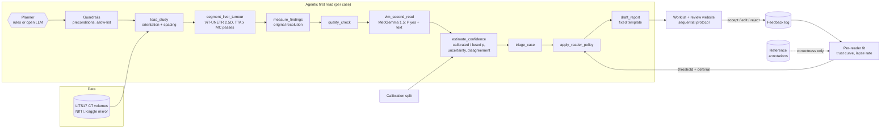

# ReaderAdapt-Liver: A self-adapting, radiologist-centred first-read agent for liver CT

> Research question of the project: *can an AI assistant adapt to the individual radiologist, rather than
> offering the same support to every reader?*

The agent performs the routine part of a read on **real liver CT (LiTS17)** - it **triages the worklist, segments
and measures liver tumours with a ViT-UNETR 2.5D, gets a second opinion from the medical vision-language model
MedGemma 1.5, attaches a calibrated confidence and drafts a structured report**. The radiologist stays responsible
for every decision and **accepts, edits or rejects** each suggestion. Those actions are logged and used to learn
**how each reader uses the AI**, so the system can change its suggestion threshold and **defer** cases to an
independent read for readers (and cases) where its help would do more harm than good.

> ⚠️ **Research prototype - not for clinical use.** Public, de-identified data only. Simulated readers show that
> the method behaves as designed; they are not evidence of clinical benefit.


## Contents
1. [What is in the box](#1-what-is-in-the-box)
2. [Architecture](#2-architecture)
3. [Data: LiTS17](#3-data-lits17)
4. [Run it (Colab GPU, ~2-3 h)](#4-run-it)
5. [5-minute walkthrough of the website](#5-five-minute-walkthrough)
6. [Methods](#6-methods)
7. [Results](#7-results)
8. [Repository layout, adapters, tests](#8-repository-layout-adapters-and-tests)
9. [Limitations and next steps](#9-limitations-and-next-steps)


## 1. What is in the box

| | Component | Where |
|---|---|---|
| **Aim 1 - agentic first read** | Planner (deterministic rules **or an open LLM** through any OpenAI-compatible server, e.g. Ollama) that calls guarded tools: load study → segment → measure → QC → **MedGemma second read** → calibrated confidence → triage → reader policy → report | `radagent/agent/` |
| | Segmentation tool: **ViT-UNETR 2.5D** (my liver model, extended to liver + tumour); a 2.5D U-Net or any adapter class can replace it | `radagent/models/` |
| | Second reader: **MedGemma 1.5 4B** (`google/medgemma-1.5-4b-it`) reads three-window axial slices through the predicted liver and returns P(tumour) + a short description; any VLM adapter (e.g. LLaVA-Med) can replace it | `radagent/vlm/` |
| | Measurements at **original resolution from header voxel spacing**; lesion volumes and RECIST-like diameters | `radagent/measure.py`, `radagent/geometry.py` |
| | **Confidence calibration** of the segmenter score, MedGemma's P(yes) or their **fusion** (chosen by CV on a calibration split), Brier, ECE, reliability diagrams; **tool disagreement** flags a case | `radagent/calibration.py`, `radagent/confidence.py` |
| | Deterministic, template-based **report draft**; MedGemma's text is quoted verbatim as *unverified* and checked for sizes the measurement tool did not produce | `radagent/report.py`, `radagent/vlm/guard.py` |
| **Aim 2 - learning from corrections** | Accept / edit / reject feedback log, **per-reader trust curve**, reader-specific threshold and **learning to defer** | `radagent/policy.py`, `radagent/readers/` |
| **Aim 3 - evaluation** | Simulated readers A (over-reliant), B (sceptical), C (inconsistent); universal vs reader-specific vs deferral policies on the same held-out LiTS cases; RQ1-RQ3 analyses; segmenter vs MedGemma vs fused | `radagent/experiments.py`, `notebooks/evaluation.ipynb` |
| Reading interface | A reading website built around the radiologist's journey and two external design reviews: no sidebar, CT viewer as the main workspace, blind first read (no AI output before your own impression, saved at once), evidence and limitations in reading order, a decision footer that stays visible with explicit save states, unsaved-work guard, session-locked settings, decision policies used only after an attributed authorisation, explicit failure states, separate mobile case cards; semantic navy / teal / amber / red / slate palette with WCAG AA contrast, 44 px targets, keyboard shortcuts - see [`docs/UX_DESIGN.md`](docs/UX_DESIGN.md) | `app/` |


## 2. Architecture



* **Tools compute, planners only choose.** A planner proposes the next tool; the runner checks it against an
  allow-list and the tool's preconditions and falls back to the rule planner (logged as a *guardrail override*)
  if the proposal is invalid. The planner LLM never sees pixels and never writes a finding.
* **The VLM is a second reader, not the measurer.** MedGemma cannot segment; volumes and diameters always come
  from the segmentation. MedGemma contributes a probability that is calibrated and fused like any other score,
  and a description that is shown as unverified text.
* **Feedback never becomes ground truth.** Reader actions teach the system *how this reader uses the AI*;
  whether a decision was right always comes from the reference annotation.

---

## 3. Data: LiTS17

The project runs on the **Liver Tumor Segmentation Challenge (LiTS17)** data (ISBI 2017 / MICCAI 2017), from its
Kaggle mirror in two parts:

* [`andrewmvd/liver-tumor-segmentation`](https://www.kaggle.com/datasets/andrewmvd/liver-tumor-segmentation) -
  `segmentations/` (all 131 masks) and `volume_pt1` … `volume_pt5`;
* [`andrewmvd/liver-tumor-segmentation-part-2`](https://www.kaggle.com/datasets/andrewmvd/liver-tumor-segmentation-part-2) -
  the remaining `volume_pt*` folders.

`volume-N.nii` holds the CT in Hounsfield units, `segmentation-N.nii` the labels 0 = background, 1 = liver,
2 = tumour. `python -m radagent download` fetches both parts with `kagglehub` (cached afterwards), `python -m
radagent data` pairs every volume with its mask across both parts (`lits_000` … `lits_130`) and writes the split.
The default **notebook-compatible split** reproduces the ViT-UNETR liver notebook (`RandomState(42)`, 80-case
training pool → train 68 / val 12) and divides its 51 held-out cases into **calib 26 / test 25**, so a
warm-started model has never seen a calibration or test case. Float-typed LiTS volumes are read in chunks and
kept as int16 when their values are integral.

---

## 4. Run it

### 4.1 Whole pipeline on Google Colab (GPU)

Open [`notebooks/colab_lits_pipeline.ipynb`](notebooks/colab_lits_pipeline.ipynb) in Colab, choose a GPU runtime
and add two **Secrets**:

| Secret | For | How |
|---|---|---|
| `KAGGLE_API_TOKEN` (or `KAGGLE_USERNAME` + `KAGGLE_KEY`) | LiTS download | kaggle.com → Settings → API |
| `HF_TOKEN` | MedGemma weights | accept the Health AI Developer Foundations terms on [huggingface.co/google/medgemma-1.5-4b-it](https://huggingface.co/google/medgemma-1.5-4b-it), then create a read token |

Run all cells: download → split → train the 3-class ViT-UNETR → segment + measure → MedGemma second read →
calibrate → agentic first read + reports → reader experiment → figures. The last cells either **open the website
directly from Colab** (public `trycloudflare.com` link; everything works there, including recomputing a case from
its CT) or download `lits_run.zip`. A full run takes roughly 2-3 h on a T4 (less on an L4/A100); `QUICK = True`
gives a ~40-case first look.

The same steps on any GPU machine:

```bash
git clone https://github.com/AIVIETNAM-AIO-khaisiubeo/ReaderAdapt-Liver.git && cd ReaderAdapt-Liver
pip install -r requirements.txt -r requirements-deep.txt -r requirements-vlm.txt
export KAGGLE_API_TOKEN=...  HF_TOKEN=...
python -m radagent all --config configs/lits.yaml        # or step by step:
# download | data | train | infer | vlm | calibrate | first-read | simulate | figures
```

### 4.2 Website on your own computer (no GPU needed)

```bash
pip install -U -r requirements.txt          # needs Streamlit 1.59 or newer
# unzip lits_run.zip into the outputs/ folder, then
python -m streamlit run app/streamlit_app.py -- --run outputs/lits
```

Everything in the website works from the stored run. Only *Recompute from the CT file* needs the LiTS files on
that computer (found through `data.lits_dirs` or a previous `download`), PyTorch and - for MedGemma - a GPU.
Single-case agent demo from the command line:

```bash
python -m radagent agent --config configs/lits.yaml                    # rule planner, cached perception
python -m radagent agent --config configs/lits.yaml --planner llm      # open LLM planner (see below)
python -m radagent agent --config configs/lits.yaml --recompute        # re-run ViT-UNETR + MedGemma on the CT
```

**Open-LLM planner (optional).** Install [Ollama](https://ollama.com), `ollama pull qwen2.5:7b-instruct`, keep
`ollama serve` running; `agent.llm` in the config points at `http://localhost:11434/v1`. Any OpenAI-compatible
server (vLLM, LM Studio, llama.cpp) works. If the server is unreachable or a proposal is invalid, the rule planner
takes over and the trace says so.

**Re-using the ViT-UNETR liver model.** The architecture is taken from my liver-segmentation notebook
(ImageNet ViT-Small encoder, U-Net decoder, CNN side-branch, 2.5D input). Changes:

* 3 output classes (background / liver / tumour), `Dropout2d` before the head for MC-dropout uncertainty;
* **warm start** from the 2-class liver checkpoint - every tensor except the 2-class head is loaded
  (`segmenter.init_from`, see `checkpoints/README.md`);
* the cosine LR schedule spans all optimiser steps (the notebook's `CosineAnnealingLR(T_max=epochs)` was stepped
  per batch, so the LR restarted every 30 steps);
* Dice + class-weighted CE on liver *and* tumour, tumour-slice oversampling, model selection on validation Dice.

## 5. Five-minute walkthrough

There is no sidebar: one compact top bar holds the product and research label, the two working modes -
**Worklist** and **Read case** - and two menus, **Session** and **Research**. Design notes, the radiologist journey
and the responses to the design reviews: [`docs/UX_DESIGN.md`](docs/UX_DESIGN.md).

1. **Session** (menu) - reader, reading mode (*Blind first read* or *AI-assisted triage*), decision policy and
   worklist, plus the session, model-set and policy ids (copyable). These settings **lock** after your first saved
   impression or decision; **Start a new session** unlocks them and loads the latest authorised policy.
2. **Worklist** - a queue summary that keeps four kinds of status apart (workflow counts, technical QC issues and,
   in AI-assisted triage only, *urgent by AI rule* and *AI models disagree*), one primary action (**Open next
   unread case**) and a table. In the default **blind first read** the table has no AI column at all:
   *# · Case · Image / AI QC · Reading status · Open*, in arrival order; a QC failure says what can still be done
   (*images can be read manually* / *check the series*). On a phone the list becomes separate case cards
   (*Case 01*, case id and status, QC, AI visibility, one *Open case* action).
3. **Read case** - one case bar (case id, status, *CT abdomen · axial · n slices · case k of n*, reading progress,
   **Previous** / *Go to case* / **Next**, or **P** / **N**). The CT viewer takes about 60 % of the width (*Large
   image* in the *Image* menu: about 70 %). Its toolbar is grouped: **Image** (window/level presets labelled with
   their values, e.g. *Liver · W 150 / L 70 HU*, custom W/L, zoom, pan, layout), **Overlays** (AI liver contour, AI
   lesion contour with optional fill - off by default - and the uncertainty map with opacity), **Original CT
   (O)** to hide every overlay, and **Reset**. A status line shows the active W/L, zoom and overlays and when a
   mask is locked, withheld or absent on the slice; **J** / **K** step slices.
   The side panel scrolls on its own and has three sections: **01 Independent read** (save your impression - it is
   written to disk at once), **02 Evidence and limitations** in reading order (AI finding → calibrated probability
   and its target → uncertainty and validity → model agreement and what it means → supporting evidence on demand)
   and **03 Decision**, a footer that stays visible: final finding, **Save decision**, **Defer…** with a reason,
   and a save state (*Not saved / Unsaved changes / Saved hh:mm / Save failed*). The saved summary states the case,
   time, impression → final finding, the relation to the AI and *research decision saved · report draft not
   signed*; **Revise decision…** records a new decision that names the one it revises.
   Leaving a case with unsaved work (Next, Go to case, the mode switch, a menu) asks: **Save and continue**,
   **Discard and continue** or **Stay on this case**. Reopening a case after an interruption resumes with the
   saved impression.
4. **Research** (menu):
   * **Reader adaptation** - the policy active in this session next to the policy proposed from the logged
     decisions. A proposal is used only after **Authorise for future sessions** (name and role, reason,
     confirmation); it is versioned, logged and takes effect from the next session. For a simulated reader
     (Reading as *Reader B*, say), **Simulate N reads** runs an offline simulation that changes nothing.
   * **Model performance** - segmentation model vs second-reader model vs combined, calibration, simulated-reader
     policy comparison and all figures.
   * **Audit trail** - the independent impression, every decision on the case with the recommendation that was on
     screen, policy and model-set versions, and revisions; the agent's tool calls; re-run or recompute from the CT.
   * **About and intended use** - what it is and is not for, the supported-device policy and what happens when
     something fails.
   * **Show the reference annotation** overlays the dataset's reference and labels each decision as a correct
     acceptance, harmful acceptance, correct or wrong rejection. A link such as `?view=read&case=lits_028` opens a
     case directly.

A `VLMReader` receives the list of RGB slices and returns `{"p_yes": float, "text": str}` - for LLaVA-Med that is
a wrapper around its own generation code. `vlm: {backend: none}` runs the agent without a second reader.

**Tests** need no GPU and no download: they write small CT volumes in the Kaggle LiTS layout and run the whole
pipeline (manifest → segmenter → MedGemma tool → calibration → agent → reports → reader experiment → figures, and a
recompute from the CT) with stand-in adapter classes; MedGemma's token scoring, prompt layout and text guard are
tested with a fake tokenizer. `tests/test_app.py` drives the real website with Streamlit's AppTest and checks the
safety rules as behaviour: no AI output (and no AI column) for unread cases in a blind first read, AI evidence only
after a saved impression, impressions persisted and resumed after an interruption, settings locked after the first
save, the unsaved-work guard (save / discard / stay), revisions that never overwrite, decisions stored with the
recommendation on screen and the session / policy / model versions, a policy used only after an attributed
authorisation and only from the next session, explicit failure states (QC, missing images, a failed save), *defer*
without a final finding; plus every view for every reader, the mobile cards and the colour palette against WCAG AA.

```bash
pip install -r requirements-dev.txt && pytest -q
```

## 9. Limitations and next steps

* **Single dataset, small held-out set.** LiTS17 only (several centres, mostly with tumour); 26 calibration and 25
  test cases, so intervals are wide and case-level specificity rests on few tumour-free volumes
  (`confidence.target_min_tumour_ml` defines an "actionable burden" alternative). An external test set is next.
* **MedGemma is used zero-shot.** It sees 16 slices, not the full volume, and has not been fine-tuned on LiTS;
  its probability is only trusted after calibration and its text is never used for measurements or triage.
  Fine-tuning (e.g. LoRA on LiTS slices) and lesion-level prompting are natural extensions.
* **Simulated readers** are a parametric model of automation bias (Yu et al. 2024; Dratsch et al. 2023). The
  pilot with mentor radiologists (Aim 3) is what tests whether real readers behave like any of them.
* **Safe online learning.** The prototype adapts the *policy*, not the networks; edits are logged (kept lesions,
  edited volume) so that a later model update can be gated against reference/consensus labels.
* Next: MRI (e.g. CHAOS / AMOS), lesion-level deferral, a VLM-assisted report that may only cite measured values,
  and reading-time logging in the website for the pilot.
