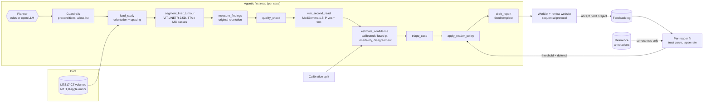

# ReaderAdapt-Liver: A self-adapting, radiologist-centred first-read agent for liver CT

> Research question of the project: *can an AI assistant adapt to the individual radiologist, rather than
> offering the same support to every reader?*

The agent performs the routine part of a read on **real liver CT (LiTS17)** - it **triages the worklist, segments
and measures liver tumours with a ViT-UNETR 2.5D, gets a second opinion from the medical vision-language model
MedGemma 1.5, attaches a calibrated confidence and drafts a structured report**. The radiologist stays responsible
for every decision and **accepts, edits or rejects** each suggestion. Those actions are logged and used to learn
**how each reader uses the AI**, so the system can change its suggestion threshold and **defer** cases to an
independent read for readers (and cases) where its help would do more harm than good.

> ⚠️ **Research prototype - not for clinical use.** Public, de-identified data only. Simulated readers show that
> the method behaves as designed; they are not evidence of clinical benefit.


## Contents
1. [What is in the box](#1-what-is-in-the-box)
2. [Architecture](#2-architecture)
3. [Data: LiTS17](#3-data-lits17)
4. [Run it (Colab GPU, ~2-3 h)](#4-run-it)
5. [5-minute walkthrough of the website](#5-five-minute-walkthrough)
6. [Methods](#6-methods)
7. [Results](#7-results)
8. [Repository layout, adapters, tests](#8-repository-layout-adapters-and-tests)
9. [Limitations and next steps](#9-limitations-and-next-steps)


## 1. What is in the box

| | Component | Where |
|---|---|---|
| **Aim 1 - agentic first read** | Planner (deterministic rules **or an open LLM** through any OpenAI-compatible server, e.g. Ollama) that calls guarded tools: load study → segment → measure → QC → **MedGemma second read** → calibrated confidence → triage → reader policy → report | `radagent/agent/` |
| | Segmentation tool: **ViT-UNETR 2.5D** (my liver model, extended to liver + tumour); a 2.5D U-Net or any adapter class can replace it | `radagent/models/` |
| | Second reader: **MedGemma 1.5 4B** (`google/medgemma-1.5-4b-it`) reads three-window axial slices through the predicted liver and returns P(tumour) + a short description; any VLM adapter (e.g. LLaVA-Med) can replace it | `radagent/vlm/` |
| | Measurements at **original resolution from header voxel spacing**; lesion volumes and RECIST-like diameters | `radagent/measure.py`, `radagent/geometry.py` |
| | **Confidence calibration** of the segmenter score, MedGemma's P(yes) or their **fusion** (chosen by CV on a calibration split), Brier, ECE, reliability diagrams; **tool disagreement** flags a case | `radagent/calibration.py`, `radagent/confidence.py` |
| | Deterministic, template-based **report draft**; MedGemma's text is quoted verbatim as *unverified* and checked for sizes the measurement tool did not produce | `radagent/report.py`, `radagent/vlm/guard.py` |
| **Aim 2 - learning from corrections** | Accept / edit / reject feedback log, **per-reader trust curve**, reader-specific threshold and **learning to defer** | `radagent/policy.py`, `radagent/readers/` |
| **Aim 3 - evaluation** | Simulated readers A (over-reliant), B (sceptical), C (inconsistent); universal vs reader-specific vs deferral policies on the same held-out LiTS cases; RQ1-RQ3 analyses; segmenter vs MedGemma vs fused | `radagent/experiments.py`, `notebooks/evaluation.ipynb` |
| Reading interface | A reading website built around the radiologist's journey and an external design review: blind first read (no AI output before your own impression), CT-first reading view, separate AI-evidence and decision panels, session-frozen and versioned decision policy, decisions logged with the recommendation on screen; semantic navy / teal / amber / red / slate palette with WCAG AA contrast, 44 px targets, keyboard shortcuts - see [`docs/UX_DESIGN.md`](docs/UX_DESIGN.md) | `app/` |


## 2. Architecture



* **Tools compute, planners only choose.** A planner proposes the next tool; the runner checks it against an
  allow-list and the tool's preconditions and falls back to the rule planner (logged as a *guardrail override*)
  if the proposal is invalid. The planner LLM never sees pixels and never writes a finding.
* **The VLM is a second reader, not the measurer.** MedGemma cannot segment; volumes and diameters always come
  from the segmentation. MedGemma contributes a probability that is calibrated and fused like any other score,
  and a description that is shown as unverified text.
* **Feedback never becomes ground truth.** Reader actions teach the system *how this reader uses the AI*;
  whether a decision was right always comes from the reference annotation.

---

## 3. Data: LiTS17

The project runs on the **Liver Tumor Segmentation Challenge (LiTS17)** data (ISBI 2017 / MICCAI 2017), from its
Kaggle mirror in two parts:

* [`andrewmvd/liver-tumor-segmentation`](https://www.kaggle.com/datasets/andrewmvd/liver-tumor-segmentation) -
  `segmentations/` (all 131 masks) and `volume_pt1` … `volume_pt5`;
* [`andrewmvd/liver-tumor-segmentation-part-2`](https://www.kaggle.com/datasets/andrewmvd/liver-tumor-segmentation-part-2) -
  the remaining `volume_pt*` folders.

`volume-N.nii` holds the CT in Hounsfield units, `segmentation-N.nii` the labels 0 = background, 1 = liver,
2 = tumour. `python -m radagent download` fetches both parts with `kagglehub` (cached afterwards), `python -m
radagent data` pairs every volume with its mask across both parts (`lits_000` … `lits_130`) and writes the split.
The default **notebook-compatible split** reproduces the ViT-UNETR liver notebook (`RandomState(42)`, 80-case
training pool → train 68 / val 12) and divides its 51 held-out cases into **calib 26 / test 25**, so a
warm-started model has never seen a calibration or test case. Float-typed LiTS volumes are read in chunks and
kept as int16 when their values are integral.

---

## 4. Run it

### 4.1 Whole pipeline on Google Colab (GPU)

Open [`notebooks/colab_lits_pipeline.ipynb`](notebooks/colab_lits_pipeline.ipynb) in Colab, choose a GPU runtime
and add two **Secrets**:

| Secret | For | How |
|---|---|---|
| `KAGGLE_API_TOKEN` (or `KAGGLE_USERNAME` + `KAGGLE_KEY`) | LiTS download | kaggle.com → Settings → API |
| `HF_TOKEN` | MedGemma weights | accept the Health AI Developer Foundations terms on [huggingface.co/google/medgemma-1.5-4b-it](https://huggingface.co/google/medgemma-1.5-4b-it), then create a read token |

Run all cells: download → split → train the 3-class ViT-UNETR → segment + measure → MedGemma second read →
calibrate → agentic first read + reports → reader experiment → figures. The last cells either **open the website
directly from Colab** (public `trycloudflare.com` link; everything works there, including recomputing a case from
its CT) or download `lits_run.zip`. A full run takes roughly 2-3 h on a T4 (less on an L4/A100); `QUICK = True`
gives a ~40-case first look.

The same steps on any GPU machine:

```bash
git clone https://github.com/AIVIETNAM-AIO-khaisiubeo/ReaderAdapt-Liver.git && cd ReaderAdapt-Liver
pip install -r requirements.txt -r requirements-deep.txt -r requirements-vlm.txt
export KAGGLE_API_TOKEN=...  HF_TOKEN=...
python -m radagent all --config configs/lits.yaml        # or step by step:
# download | data | train | infer | vlm | calibrate | first-read | simulate | figures
```

### 4.2 Website on your own computer (no GPU needed)

```bash
pip install -U -r requirements.txt          # needs Streamlit 1.59 or newer
# unzip lits_run.zip into the outputs/ folder, then
python -m streamlit run app/streamlit_app.py -- --run outputs/lits
```

Everything in the website works from the stored run. Only *Recompute from the CT file* needs the LiTS files on
that computer (found through `data.lits_dirs` or a previous `download`), PyTorch and - for MedGemma - a GPU.
Single-case agent demo from the command line:

```bash
python -m radagent agent --config configs/lits.yaml                    # rule planner, cached perception
python -m radagent agent --config configs/lits.yaml --planner llm      # open LLM planner (see below)
python -m radagent agent --config configs/lits.yaml --recompute        # re-run ViT-UNETR + MedGemma on the CT
```

**Open-LLM planner (optional).** Install [Ollama](https://ollama.com), `ollama pull qwen2.5:7b-instruct`, keep
`ollama serve` running; `agent.llm` in the config points at `http://localhost:11434/v1`. Any OpenAI-compatible
server (vLLM, LM Studio, llama.cpp) works. If the server is unreachable or a proposal is invalid, the rule planner
takes over and the trace says so.

**Re-using the ViT-UNETR liver model.** The architecture is taken from my liver-segmentation notebook
(ImageNet ViT-Small encoder, U-Net decoder, CNN side-branch, 2.5D input). Changes:

* 3 output classes (background / liver / tumour), `Dropout2d` before the head for MC-dropout uncertainty;
* **warm start** from the 2-class liver checkpoint - every tensor except the 2-class head is loaded
  (`segmenter.init_from`, see `checkpoints/README.md`);
* the cosine LR schedule spans all optimiser steps (the notebook's `CosineAnnealingLR(T_max=epochs)` was stepped
  per batch, so the LR restarted every 30 steps);
* Dice + class-weighted CE on liver *and* tumour, tumour-slice oversampling, model selection on validation Dice.

## 5. Five-minute walkthrough

The website has two working modes - **Worklist** and **Read case** - and a separate **Research and quality**
area in the sidebar. Design notes, the radiologist journey and the response to the design review:
[`docs/UX_DESIGN.md`](docs/UX_DESIGN.md).

1. **Worklist** - a slim session bar (reader, reading mode, session and model-set ids, research label), a one-line
   queue summary and a dense table: position, case, *Image / AI QC* (operational), *AI finding*, status and one
   **Open** action. In the default **blind first read** the cases are in arrival order and the AI finding stays
   hidden (*Hidden until your impression*); switch *Reading mode* to **AI-assisted triage** in the sidebar to see
   AI categories, probabilities, tool disagreement and the AI priority order. Use *Show*, *Find case* and
   *Details* in the toolbar.
2. **Read case** - previous / next (or **P** / **N**) and a case picker, then three steps:
   *Independent read → Reveal AI evidence → Reconcile and decide*. The CT viewer opens without AI overlays
   (orientation markers, slice *n / N*, window/level presets or custom W/L in HU, zoom and pan, overlay
   opacity, **J** / **K** to step slices). Save your impression; the AI evidence then appears next to it:
   the calibrated patient-level probability, its uncertainty on a stated scale, whether the two AI tools agree on
   the class *and* the score, validity (QC), measurements and the lesion table. In **Reconcile and decide** record
   *Tumour / No tumour / Defer*, optionally modify the AI lesions, and **Save decision**; then **Next unread
   case** or **Open report**.
3. **Research and quality** (sidebar):
   * **Reader adaptation** - the policy active in this session (frozen) next to the policy proposed from the
     logged decisions; **Apply from the next case** is the only way it changes, and every change is logged.
     For a simulated reader (Reading as *Reader B*, say), **Simulate N reads** runs an offline simulation.
   * **Model performance** - segmentation model vs second-reader model vs combined, calibration, simulated-reader
     policy comparison and all figures.
   * **Audit trail** - every decision on the case with the recommendation that was on screen, policy and
     model-set versions; the agent's tool calls; re-run or recompute from the CT.
   * **About and intended use** - what it is and is not for, and the supported-device policy.

Turn on *Research mode* in the sidebar to overlay the reference annotation and label each decision as a correct
acceptance, harmful acceptance, correct or wrong rejection. A link such as `?view=read&case=lits_028` opens a
case directly.

## 6. Methods

### 6.1 Geometry and measurement (Step 1)
Every NIfTI is re-ordered to the closest canonical **RAS+** orientation from its affine (LiTS mixes storage
orders) and shown in the radiological axial view (patient right on the left, anterior up). Voxel spacing is read
from the header, never assumed. Inference runs at 256 px, the **class probabilities are resized back to the
original grid** and every volume is `n_voxels × dz × drow × dcol`. Lesions are 3D connected components inside the
liver that are ≥ `min_lesion_ml` (0.1 ml) and reach a peak tumour probability ≥ 0.7; for each: volume, longest
axial diameter on its largest cross-section, slice range, mean HU, mean probability.

### 6.2 Two-stage, uncertainty-aware segmentation
Stage 1: one deterministic pass over all slices locates the liver slab. Stage 2: all stochastic passes on the
slab only - **flip-TTA × MC-dropout** (2 × 2 = 4 passes by default).

### 6.3 MedGemma 1.5 second reader
`vlm_second_read` follows the CT recipe of Google's MedGemma notebooks: 16 axial slices spread evenly over the
**predicted liver extent** (superior → inferior), each converted to an RGB image whose channels are three CT
windows (−1024…1024, −135…215, 0…80 HU), interleaved with `SLICE n` labels after a radiologist instruction.

* **Score.** For "is there at least one focal liver lesion suspicious for a liver tumour? Answer yes or no" the
  model generates one token; `P(yes)` = probability mass of the single-token *yes* variants against the *no*
  variants at that position (the mass on these tokens is stored as a sanity check). A number can be calibrated
  and fused; free text cannot.
* **Description.** A second, greedy generation describes the liver and ends with `Final Answer: yes/no`. It is
  shown and reported **verbatim as unverified model text**; a guard flags sizes that no measured lesion supports
  and a written conclusion that contradicts the model's own `P(yes)`.
* **Precision.** bf16 on Ampere or newer GPUs; on a T4 the weights are loaded in 4-bit (NF4) with float32
  compute, avoiding the float16 overflow of Gemma 3 models.
* **Caching.** Reads are stored per case with a signature of model, prompt version, slice count and windows, and
  of the segmentation they were sampled from; the agent reuses them unless asked to recompute.

### 6.4 Case-level score, calibration, uncertainty (Step 2)
* Segmenter score `p_seg` = mean of the *k* highest (slightly smoothed) tumour probabilities inside the liver,
  *k* voxels = 0.1 ml - "is there a lesion of at least 0.1 ml the model believes in?".
* Calibration on the **calibration split only**. Candidates: identity, temperature scaling and Platt scaling of
  `p_seg`, Platt scaling of MedGemma's `P(yes)`, and a **fused** logistic model on both logits (weak ridge
  towards equal weights). The winner is selected by stratified 5-fold CV negative log-likelihood, refitted on
  the whole calibration split and evaluated **once** on the test split (Brier, ECE with equal-width and
  equal-mass bins, NLL, AUROC, 95 % bootstrap intervals, reliability diagram). Each tool is also calibrated and
  evaluated on its own for the comparison table.
* `uncertainty` = predictive entropy (bits) of the calibrated probability. The stochastic segmentation passes
  give the decomposition *total = expected entropy (aleatoric) + mutual information (epistemic)*; both parts are
  reported.
* **Disagreement.** When the calibrated segmenter and MedGemma probabilities fall on different sides of 0.5, the
  case is flagged: it receives a priority bonus and is never labelled LIKELY NORMAL.

### 6.5 Quality control and triage (Step 3)
QC checks (liver found, plausible liver volume, spacing, slice count, tumour voxels outside the liver) route a
case to a manual read. Priority = 0.60 · p + 0.25 · log-volume term + 0.15 · uncertainty (+ 0.10 if the two AI
tools disagree), categories URGENT / SUSPICIOUS / UNCERTAIN / LIKELY NORMAL / QC FAIL. The report is a fixed
template filled with these values.

### 6.6 Reader model, feedback and personalisation (Step 4)
Simulated readers follow a **sequential reading protocol**: independent impression → AI suggestion → final
decision. Own reads depend on lesion size **and conspicuity** (`P(call) = σ(a + b·log10 V + c·(|Δ| − 20)/10)`,
Δ = tumour-minus-liver attenuation measured from the LiTS image and its reference mask, so small or faint lesions
are missed by readers *and* the model); tumour-free cases get a fixed false-positive rate. On disagreement the
reader switches to the AI with probability `σ(k·(conf − τ))` (*trust curve*); lapses make decisions random; poor
outlines are edited.

| | own-read sensitivity | false-positive rate | trust curve | lapses | role |
|---|---|---|---|---|---|
| Reader A | medium | 12 % | switches easily (τ = 0.55, k = 8) | 2 % | over-reliant |
| Reader B | conservative (misses small lesions) | 4 % | almost never switches (τ = 0.97) | 2 % | sceptical, rejects many |
| Reader C | lower | 15 % | flat (k = 1.5) | 15 % | inconsistent |

From a reader's feedback the system fits that reader's **trust curve** (MAP logistic regression with a weak
prior) and **lapse rate**. Because the independent impressions do not depend on the policy, the expected loss of
any candidate policy on the reader's past cases follows in closed form:

`loss = 2·FN + 1·FP + 0.02·review actions`   (a missed tumour costs twice a false alarm)

A grid search over the suggestion threshold (0.10-0.90) and the deferral cut-off (uncertainty ≥ 0.3 … never)
picks the best policy (with a small shrinkage penalty towards the universal threshold). It is adopted only with
≥ 10 feedback events **and** if its expected improvement exceeds one standard error of the paired per-case
difference (and a 0.005 floor); otherwise the reader keeps the universal policy - a guard against overfitting
small feedback logs.

Policies compared: **Reader alone** (control) · **Universal threshold** (0.5) · **Universal + deferral** (one
deferral rule from pooled feedback) · **Reader-specific threshold** · **Reader-specific + deferral**.

### 6.7 Evaluation protocol (Step 5)
Burn-in: each reader reads the 26 calibration cases (random order per seed) with the universal policy →
policies are fitted → every policy is applied to the **same 25 test cases with the same random draws** (common
random numbers), 30 seeds. Learning curves repeat the fit with the first *n* feedback events.

| Metric | Meaning |
|---|---|
| Dice (liver, tumour) | segmentation overlap at original resolution |
| AUROC / Brier / ECE / NLL | case-level detection and confidence reliability: segmenter, MedGemma, fused; before and after calibration |
| Sensitivity / specificity | case-level detection (AI alone and final reader decision) |
| Deferral rate | share of cases where the suggestion was withheld |
| Harmful-acceptance rate | accepted an incorrect AI suggestion (per case); *over-reliance* = per incorrect suggestion shown |
| Review actions per case | burden proxy: accept 1, reject 2, edit 3, independent read 4 |

## 7. Results

The earlier synthetic-phantom demo run and its numbers were removed together with the synthetic data. Results on
LiTS17 come from running section 4.1; every number is then regenerated from the run folder by
[`notebooks/evaluation.ipynb`](notebooks/evaluation.ipynb) (set `RUN = outputs/lits`), and the figures are written
to `outputs/lits/figures/`:

| Figure | Question |
|---|---|
| `ai_tools.png` | Segmenter vs MedGemma vs the fused score: ROC on the test split, and where the two tools disagree |
| `segmentation_quality.png` | Liver and tumour Dice per test case |
| `calibration_reliability.png` | Is the confidence calibrated? |
| `risk_coverage.png`, `triage_lift.png` | Does uncertainty find the AI's errors; does the worklist surface tumour cases first? |
| `policy_comparison.png`, `benefit_by_reader.png`, `learning_curve.png` | RQ1-RQ3 with the simulated readers |

With 25 test cases, intervals are wide and LiTS contains few tumour-free volumes, so report the bootstrap intervals
alongside every point estimate.

## 8. Repository layout, adapters and tests

```
radagent/
  agent/         tools.py (tool registry + preconditions, incl. vlm_second_read), planner.py (rule / open-LLM),
                 runner.py (guarded loop), llm_client.py
  data/lits.py   kagglehub download, pairing across both Kaggle parts, notebook-compatible split, file relocation
  models/        torch_models.py (ViT-UNETR 2.5D, UNet25D, MC dropout), base.py (Segmenter interface)
  vlm/           base.py (VLMReader interface), medgemma.py (MedGemma 1.5 adapter), ct_prep.py (windows, slices),
                 prompts.py (versioned prompts), guard.py (checks on model text)
  plugins.py     load any adapter class from "package.module:Class"
  io/nifti.py    NIfTI-1 I/O (nibabel, chunked float reading, dependency-free fallback)
  geometry.py    affine -> RAS+ canonical, radiological view, spacing, volumes
  inference.py   two-stage stochastic inference, post-processing, case score
  measure.py     original-resolution measurement, reference metrics, viewer arrays
  calibration.py temperature / Platt / VLM / fused, CV selection, Brier, ECE, reliability, bootstrap
  confidence.py  calibrated probability + uncertainty + tool disagreement
  quality.py, triage.py, report.py
  policy.py      reader policies, trust-curve fit, expected-loss optimisation, deferral
  readers/       simulated reader profiles, feedback log
  experiments.py controlled reader experiment, RQ1-RQ3 aggregates
  plots.py, pipeline.py, cli.py, config.py, store.py
app/             streamlit_app.py (website, one view per journey stage), ui_theme.py (colour tokens, CSS, accessible
                 HTML components), ui_core.py (rendering + live adaptation, Streamlit-free)
docs/            UX_DESIGN.md (radiologist journey, design rules, contrast table)
configs/         lits.yaml (LiTS17 + ViT-UNETR + MedGemma)
notebooks/       colab_lits_pipeline.ipynb (full run on Colab), evaluation.ipynb (reproducible evaluation)
tests/           unit + end-to-end tests, website tests (Streamlit AppTest); fixtures/ = small CTs in the Kaggle
                 LiTS layout and stand-in models
```

**Swapping a model.** Both tools are adapter classes behind small interfaces, selected in the config:

```yaml
segmenter: {backend: plugin, plugin: "my_pkg.my_module:MySegmenter"}   # implements radagent.models.base.Segmenter
vlm:       {backend: plugin, plugin: "my_pkg.llava_med:LlavaMedReader"} # implements radagent.vlm.base.VLMReader
```

A `VLMReader` receives the list of RGB slices and returns `{"p_yes": float, "text": str}` - for LLaVA-Med that is
a wrapper around its own generation code. `vlm: {backend: none}` runs the agent without a second reader.

**Tests** need no GPU and no download: they write small CT volumes in the Kaggle LiTS layout and run the whole
pipeline (manifest → segmenter → MedGemma tool → calibration → agent → reports → reader experiment → figures, and a
recompute from the CT) with stand-in adapter classes; MedGemma's token scoring, prompt layout and text guard are
tested with a fake tokenizer. `tests/test_app.py` drives the real website with Streamlit's AppTest and checks the
safety rules as behaviour: no AI output for unread cases in a blind first read, AI evidence only after a saved
impression, decisions stored with the recommendation on screen and the session / policy / model versions, a policy
that changes only when explicitly applied, QC failures that withhold the AI output, *defer* without a final finding;
plus every view for every reader and the colour palette against WCAG AA.

```bash
pip install -r requirements-dev.txt && pytest -q
```

## 9. Limitations and next steps

* **Single dataset, small held-out set.** LiTS17 only (several centres, mostly with tumour); 26 calibration and 25
  test cases, so intervals are wide and case-level specificity rests on few tumour-free volumes
  (`confidence.target_min_tumour_ml` defines an "actionable burden" alternative). An external test set is next.
* **MedGemma is used zero-shot.** It sees 16 slices, not the full volume, and has not been fine-tuned on LiTS;
  its probability is only trusted after calibration and its text is never used for measurements or triage.
  Fine-tuning (e.g. LoRA on LiTS slices) and lesion-level prompting are natural extensions.
* **Simulated readers** are a parametric model of automation bias (Yu et al. 2024; Dratsch et al. 2023). The
  pilot with mentor radiologists (Aim 3) is what tests whether real readers behave like any of them.
* **Safe online learning.** The prototype adapts the *policy*, not the networks; edits are logged (kept lesions,
  edited volume) so that a later model update can be gated against reference/consensus labels.
* Next: MRI (e.g. CHAOS / AMOS), lesion-level deferral, a VLM-assisted report that may only cite measured values,
  and reading-time logging in the website for the pilot.
